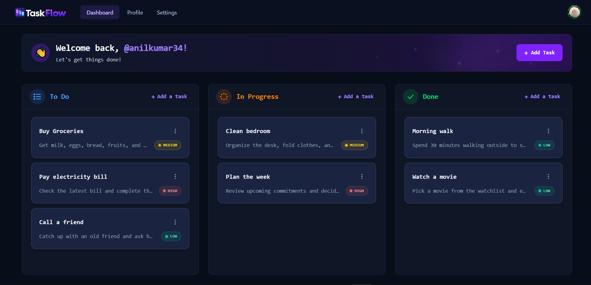
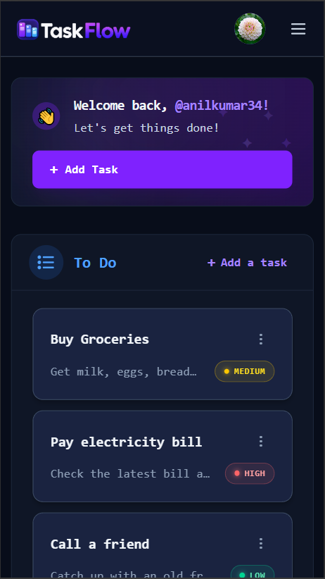
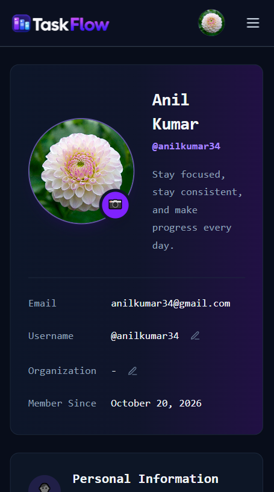
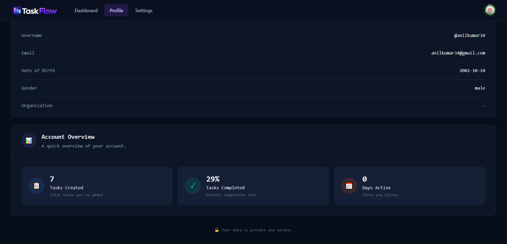
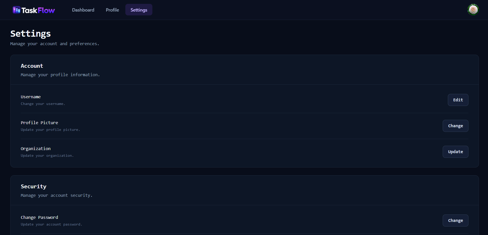

# TaskFlow (Frontend)

TaskFlow is a full-stack task management app with a drag-and-drop Kanban board. This is the **React frontend**. The backend lives in a separate repo: **[taskflow-backend](https://github.com/imhsart/trello-clone-backend.git)**

**Live demo:** https://taskflow-vwwb.onrender.com

## Features

- Sign up and log in with cookie-based authentication
- Kanban dashboard with three columns: **To Do**, **In Progress**, **Done**
- Drag and drop tasks between columns
- Add, edit and delete tasks, each with a title, description and priority (low / medium / high)
- Profile page with account details and stats (tasks created, completion rate, days active)
- Settings page to change your username, organization, profile picture and password, and to log out
- Protected routes for logged-in users, and public routes that redirect logged-in users to the dashboard
- Responsive dark UI with toast notifications

## Screenshots



| | |
| --- | --- |
|  |  |





## Tech Stack

- React 19
- Vite
- React Router v7
- Tailwind CSS v4
- Axios
- React Hot Toast
- Cloudinary (profile picture uploads)

## Project Structure

```
src/
├── Assets/           # Logo
├── Components/       # AddNewTask, EditableField, ImageUpload, Navbar,
│                     # ProtectedRoute, PublicRoutes, TaskCard
├── Layouts/          # DashboardLayout (navbar + page outlet)
├── Pages/            # Login, Signup, Dashboard, Profile, Settings
├── Utils/            # UserContext (auth state shared across the app)
├── App.jsx           # Route definitions
├── main.jsx          # App entry point
└── index.css         # Tailwind import
```

## Getting Started

### Prerequisites

- Node.js 18 or newer
- The [backend](https://github.com/imhsart/trello-clone-backend.git) running locally or deployed
- A free [Cloudinary](https://cloudinary.com) account for image uploads

### Installation

```bash
git clone https://github.com/imhsart/trello-clone-frontend.git
cd trello-clone-frontend
npm install
```

### Environment variables

Copy `.env.example` to `.env` and fill in the values:

```env
VITE_BACKEND_URL=http://localhost:8080/api
VITE_CLOUDINARY_CLOUD_NAME=your_cloud_name
VITE_CLOUDINARY_UPLOAD_PRESET=your_unsigned_upload_preset
```

| Variable | Description |
| --- | --- |
| `VITE_BACKEND_URL` | Base URL of the backend API. It must include the `/api` prefix. |
| `VITE_CLOUDINARY_CLOUD_NAME` | Your Cloudinary cloud name |
| `VITE_CLOUDINARY_UPLOAD_PRESET` | An unsigned upload preset from your Cloudinary settings |

### Run the app

```bash
npm run dev
```

The app runs at `http://localhost:5173`. Make sure the backend is running too, otherwise login and tasks won't work.

### Build for production

```bash
npm run build
npm run preview
```

## Notes
 
- Authentication uses an `httpOnly` cookie set by the backend, so all requests are sent with `withCredentials: true`.
- The backend only allows requests from specific origins (CORS). If you run the frontend on a different port or domain, add it to the allowed origins in the backend's `app.js`.

## Related
 
- Backend repo: [taskflow-backend](https://github.com/imhsart/trello-clone-backend.git)